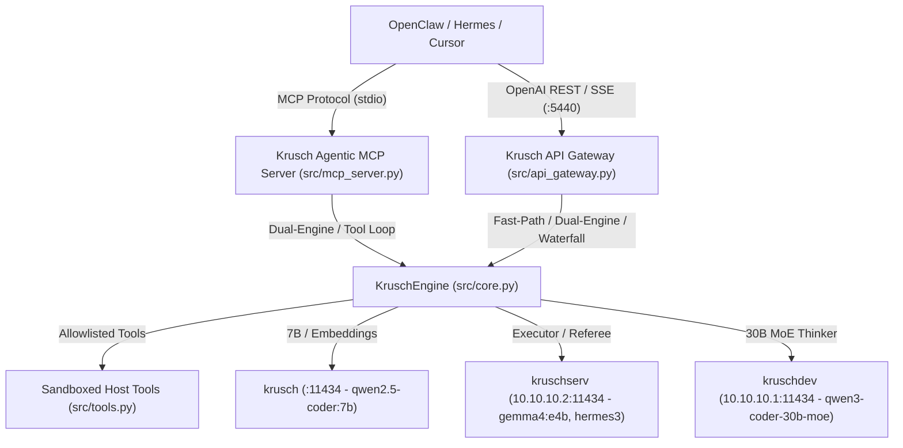

# OpenClaw, Hermes & IDE Integration Guide (`v0.4.0`)

`krusch-agentic-proxy` provides both an **OpenAI-compatible REST Gateway** (`:5440` / `:5443`) with SSE streaming (`stream: true`) and a **FastMCP Server** (`src/mcp_server.py`) that gives conversational agents an autonomous coding and tool-calling cortex backed by the **Multi-Family 5-GPU Fleet**.

## Architecture



## 1. MCP Server Setup (OpenClaw / Cursor / Claude Desktop / Antigravity)

Add the following entry to your MCP configuration JSON:

```json
{
  "mcpServers": {
    "krusch-agentic-execution": {
      "command": "/home/krusch/homelab/projects/krusch-law/.venv/bin/python",
      "args": [
        "/home/krusch/homelab/projects/krusch-agentic-proxy/src/mcp_server.py"
      ],
      "env": {
        "KRUSCH_PROXY_CONFIG": "/home/krusch/homelab/projects/krusch-agentic-proxy/config.json"
      }
    }
  }
}
```

When connected, the client gains access to `krusch_execute_task(objective: str, max_loops: int = 5)` for multi-step autonomous execution inside the `/home/krusch/homelab` workspace.

## 2. OpenAI API Gateway Setup (`:5440` / `:5443`)

Point any OpenAI-compatible client (`OPENAI_BASE_URL`) to:
- **Universal Gateway (Active Dual-Engine & Tool Routing)**: `http://127.0.0.1:5440/v1`
- **Passive Interceptor (`PASSIVE_MODE=1` for OpenClaw)**: `http://127.0.0.1:5443/v1`

Supported features:
- Non-streaming (`stream: false`) and Server-Sent Events streaming (`stream: true`) with `chat.completion.chunk` deltas and `usage` token counters.
- Automatic model-to-GPU routing (`qwen2.5-coder:7b` on `krusch`, `gemma4:e4b` & `hermes3:latest` on `kruschserv`, `qwen3-coder-30b-moe:latest` on `kruschdev`, or `"model": "auto-cloud"` for Waterfall routing).
